Jump to: [Where this comes from](#where-this-comes-from) · [At a glance](#at-a-glance) · [The eight stages](#the-eight-stages) · [The base edge](#the-base-edge) · [Further advancements](#further-advancements) · [Level 2: HCS and the limit-order approach](#level-2-hcs-and-the-limit-order-approach) · [Unresolved](#unresolved)

The callout boxes are his exact wording; quotes keep his spelling. His charts are XAUUSD.

## Where this comes from

After [Recap & Puzzle](/mrc-tasks/tasks/segments/4/assignment/) he explained the purpose of his puzzle (on that page, [collapsed](/mrc-tasks/tasks/segments/4/assignment/#his-debrief-posted-later) so you can attempt the puzzle first) and then posted:

> Now A Step by step Sequence onto final clarification entry (level 1):

Recap & Puzzle had said he would "advance through the stages of implementation step by step". This sequence appears to be those stages (an inference from the shared "step by step"; he does not link the two explicitly). The recap left out "liquidity or zones or even LTF execution yet"; this sequence adds liquidity and LTF execution.

*The worked example is a different chart from the puzzle: the puzzle sits at about 4,231-4,400 on the 30 min, this example at about 4,066-4,185 from 18hr to 3 min. It is not the puzzle solved.*

"Level 1" and, later, "level 2" are his labels for two levels of the entry. They are not Segment, Week or Reflection numbers.

## At a glance

> To memorise:
>
> Authority → Premium → Interaction → EM/TFS → Scalp → LTF Liquidity → Entry → Management.
>
> Swing tells WHAT to follow. Intraday tells WHERE the main interaction is. Scalp tells HOW the movement is developing. LTF tells WHEN and WHERE to execute.

The roles line restates the [top-down extraction cycle](/mrc-tasks/reference/top-down-extraction-cycle/#the-cycle): "Swing Campaign - Intraday Wave - Scalp Flow - LTF Timing".

His eight text headings, his chart numbers (1-8) and the eight items of the memorise line line up like this:

| Stage (his question) | Chart (his step title) | Timeframe | Memorise item |
|---|---|---|---|
| [1 · Authority](#1--authority-what-are-we-following-18hr): What are we following? | "1-Follow the highest swing" | 18hr | Authority |
| [2 · Premium](#2--premium-where-should-price-interact-4hr-3hr-1hr): Where should price interact? | "2-Mark the Established swing retest POI of the now"; "3- Mark the swing/Intraday Liquidty" (×2) | 4hr; 3hr, 1hr | Premium |
| [3 · Interaction](#3--interaction-has-the-main-structure-activated-40-min): Has the main structure activated? | "4- Mark the Intraday FU retesting swing FU (or at the start of swing)" | 40 min | Interaction |
| [4 · Confirmation](#4--confirmation-what-tfs-and-em-support-it-40-min): What TFS and EM support it? | "5-Write down the TFS and note the EM" | 40 min | EM/TFS |
| [5 · Scalp](#5--scalp-how-is-the-swing-being-expressed-9-min-6-min): How is the Swing being expressed? | "6-Mark scalp POI /liqudity" (×2) | 9 min, 6 min | Scalp |
| [6 · LTF](#6--ltf-where-is-the-precise-entry-4-min-3-min): Where is the precise entry? | "7- Complete LTF entry and TFS"; "8-Refine with 50% zone retest (optional)" | 4 min; 3 min | LTF Liquidity → Entry |
| [7 · Execution](#7--execution-is-the-entry-structurally-justified): Is the entry structurally justified? | none (the 3 min chart shows the position) | - | Entry |
| [8 · Management](#8--management-what-are-we-holding): What are we holding? | none (the 6 min chart carries his management note) | - | Management |

*Stage numbers are the order of his text headings; the step numbers in quotes are his own chart numbering, which runs 1-8 across the charts, not across the stages.*

The worked example as a whole: a **bearish swing** from the 18hr FU retest range at about 4,164.55-4,184.77; the intraday interaction at about 4,166.18-4,170.10; liquidity targets below at 4,127.92 and 4,104.49 (both already taken when the charts were captured); continuation levels at about 4,149.84 / 4,145.84 and 4,139.65 / 4,132.47; the final LTF entry at the LTF LAOL just under 4,170.10. The timeframes descend 18hr → 4hr → 3hr → 1hr → 40 min → 40 min → 9 min → 6 min → 4 min → 3 min. All ten charts were captured at the same moment (price 4,098.41).

## The eight stages

### 1 · Authority: what are we following? (18hr)

> AUTHORITY - What are we following?
>
> Identify the highest established Swing, its direction, strength and active FU premium. Do not get distracted by counter-movements or at least categorise retracement Swing strength vs macro

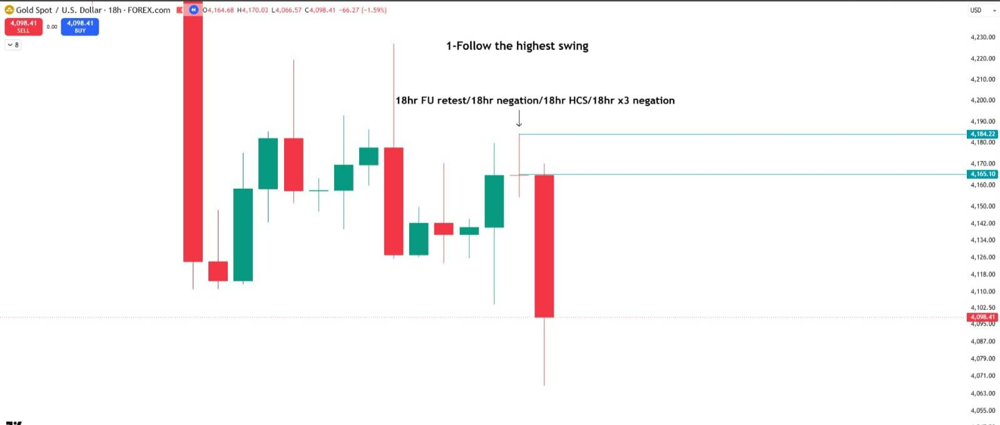

Chart annotations (18hr):

- Title: "1-Follow the highest swing"
- "18hr FU retest/18hr negation/18hr HCS/18hr x3 negation", with an arrow down to the long upper wick at about 4,184.
- Teal lines at 4,184.22 and 4,165.10 (the FU retest range).
- The next 18hr candle is a large red close at 4,098.41.

The highest swing here is a bearish 18hr structure, with four confirmation types ([FU](/mrc-tasks/reference/terminology/#fu) retest, [negation](/mrc-tasks/reference/terminology/#negation), [HCS](/mrc-tasks/reference/terminology/#hcs), [x3 negation](/mrc-tasks/reference/terminology/#x3)) on one candle.

"Categorise retracement Swing strength vs macro" echoes Segment 1's ".Start to categorise between the highest timeframe swings" ([Extension task for revision](/mrc-tasks/tasks/segments/1/assignment/#extension-task-for-revision)) and comes back as a [further advancement](#further-advancements): "Following exact macro swing vs retracement swing interactions".

### 2 · Premium: where should price interact? (4hr, 3hr, 1hr)

> PREMIUM - Where should price interact?
>
> Mark the established Swing FU retest and the relevant Intraday POI/LAOL. Distinguish the main premium from weaker internal levels.

#### 4hr: the established swing retest POI

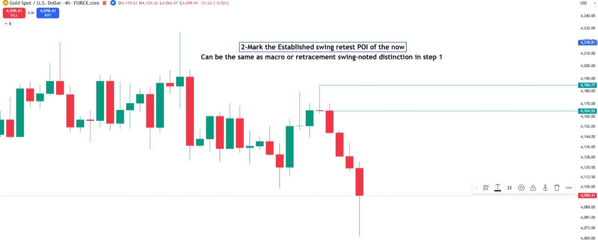

Chart annotations (4hr):

- Boxed title: "2-Mark the Established swing retest POI of the now"
- Subtitle: "Can be the same as macro or retracement swing-noted distinction in step 1"
- Teal lines at 4,184.77 and 4,164.55, from the wick high and the open of the rejection candle, extended right.
- Price then falls through four red candles to 4,098.41 (low wick about 4,066).

#### 3hr: the swing / intraday liquidity

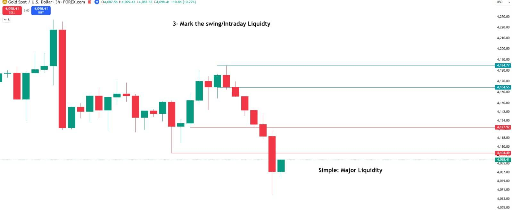

Chart annotations (3hr):

- Title: "3- Mark the swing/Intraday Liquidty"
- Bottom right: "Simple: Major Liquidity"
- Teal lines at 4,184.77 and 4,164.55.
- Red lines at 4,127.92 (from a prior low) and 4,104.49 (from a long lower wick), both swept by the decline.

#### 1hr: narrative and targets

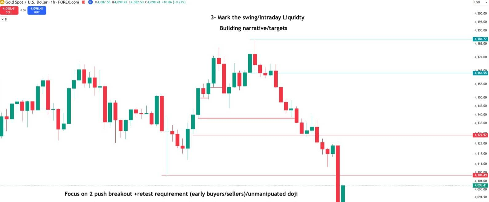

Chart annotations (1hr):

- Title: "3- Mark the swing/Intraday Liquidty"
- "Building narrative/targets"
- Bottom: "Focus on 2 push breakout +retest requirement (early buyers/sellers)/unmanipuated doji"
- Teal lines at 4,184.77 and 4,164.55; red lines at 4,127.92, 4,104.49 and an unlabelled one at about 4,139; short red marks at about 4,150 and 4,155 inside the earlier rally.

The liquidity is the narrative and the targets for the swing. "2 push breakout +retest requirement (early buyers/sellers)" is not defined further; [early buyers/sellers](/mrc-tasks/reference/top-down-extraction-cycle/#laol-and-early-buyerssellers-3hr) are otherwise described only on his Segment 3 charts. The unmanipulated doji is defined in [Task 1](/mrc-tasks/tasks/1/assignment/#the-30-chart-task).

### 3 · Interaction: has the main structure activated? (40 min)

> INTERACTION - Has the main structure activated?
>
> Look for Intraday FU/EM interacting with the Swing premium. Determine whether we are seeing the initial Swing interaction or continuation.

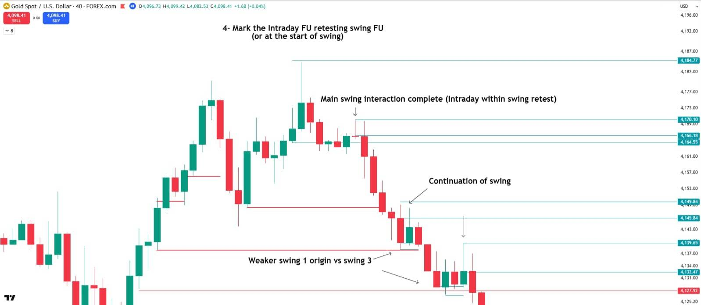

Chart annotations (40 min):

- Title: "4- Mark the Intraday FU retesting swing FU (or at the start of swing)"
- "Main swing interaction complete (Intraday within swing retest)", with an arrow down to the candle at 4,170.10.
- Teal lines at 4,184.77, 4,170.10, 4,166.18 and 4,164.55.
- Lower: "Continuation of swing", with an arrow to 4,149.84; teal lines at 4,145.84, 4,139.65 (with a down arrow) and 4,132.47; a red line at 4,127.92.
- Bottom: "Weaker swing 1 origin vs swing 3", with two arrows to red lines at about 4,138 and about 4,128.
- Red lines on the left mark earlier lows inside the rally.

The two cases his text asks you to tell apart are both on this chart: the initial swing interaction (the intraday FU inside the swing retest, at 4,170.10) and the continuation of the swing below it. The [three tradable points](/mrc-tasks/reference/top-down-extraction-cycle/#the-three-tradable-points) name the same distinction (Swing Intraday Activation, Intraday Continuation).

#### The base edge

He highlighted this chart in a reply:

> Hilghlighted concept which had been a focus of previous tasks- the base edge - ones foundational profitability:
>
> Swing retest , intraday closure within- the most fluent extraction area. Anything else and all refinement is built around its confirmed directional understanding (higher established TS "line" strength)

The base edge is what this chart labels "Intraday within swing retest". "(higher established TS "line" strength)" ties back to his puzzle debrief, where the thickest TS line is "the most power" ([Recap & Puzzle](/mrc-tasks/tasks/segments/4/assignment/#his-debrief-posted-later), collapsed).

*"A focus of previous tasks" most likely means [Segment 1 · Task 1](/mrc-tasks/tasks/segments/1/assignment/#task-1--intraday-and-swing-fu-retest-closures) (intraday and swing FU retest closures) and Segment 3's [Swing Intraday Activation](/mrc-tasks/reference/top-down-extraction-cycle/#the-three-tradable-points). That is an inference; he does not name them.*

### 4 · Confirmation: what TFS and EM support it? (40 min)

> CONFIRMATION - What TFS and EM support it?
>
> Write down the established timeframes and their negations, x3, FU or HCS. Understand which structures have closed and gained authority.

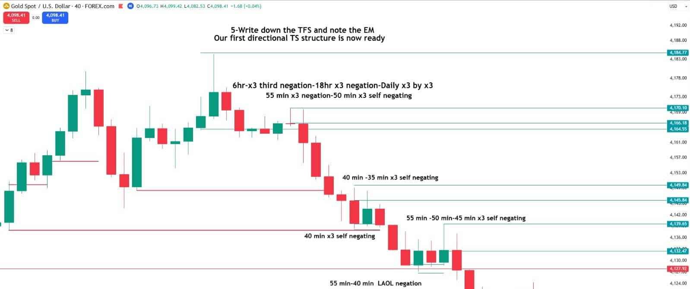

Chart annotations (40 min):

- Title: "5-Write down the TFS and note the EM / Our first directional TS structure is now ready"
- Labels, top to bottom:
  - "6hr-x3 third negation-18hr x3 negation-Daily x3 by x3" and "55 min x3 negation-50 min x3 self negating" (at the 4,164.55-4,170.10 top)
  - "40 min -35 min x3 self negating" (at 4,149.84)
  - "40 min x3 self negating" (under 4,145.84, at the red line about 4,138)
  - "55 min -50 min-45 min x3 self negating" (at 4,139.65)
  - "55 min-40 min LAOL negation" (bottom, near 4,127.92)

This is the [TFS](/mrc-tasks/reference/timeframe-strength/) write-down in practice: each level gets its timeframes and its confirmation type. From here on, the top lines are repeated as a header on every chart, and the header grows as the sequence goes down:

1. "6hr-x3 third negation-18hr x3 negation-Daily x3 by x3"
2. "55 min x3 negation-50 min x3 self negating"
3. "8 min-9 min x3 self negating" (added on the 9 min chart)
4. "4 min-3 min x3 negation" (added on the 4 min chart)

*Editorial reading, strongly supported but not stated: the four header lines match the [five TFS categories](/mrc-tasks/reference/timeframe-strength/#the-five-tfs-categories): swing / longterm swing, then intraday (30 min - 3hr), scalp (7 min - 30 min) and LTF (1 min - 5 min). Read that way, the header is "Swing tells WHAT ... Intraday WHERE ... Scalp HOW ... LTF WHEN" written down as you go.*

*"EM" is still not spelled out. This stage ("What TFS and EM support it?", "negations, x3, FU or HCS"), "qualifying EM" in the LTF stage and "EM/TFS" in the memorise line make "entry model" the more likely reading (an inference, not confirmed).* "x3 by x3" and "third negation" are not defined ([x3](/mrc-tasks/reference/terminology/#x3)).

### 5 · Scalp: how is the Swing being expressed? (9 min, 6 min)

> SCALP - How is the Swing being expressed?
>
> Identify the Scalp FU, waves and liquidity forming within the higher movement. Locate the active Scalp POI for entry refinement.

#### 9 min: the scalp POI

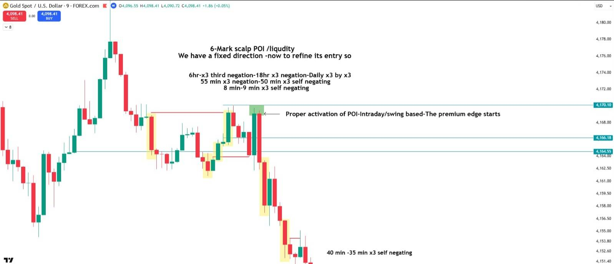

Chart annotations (9 min):

- Title: "6-Mark scalp POI /liqudity / We have a fixed direction -now to refine its entry so"
- Header: the two TFS lines above, plus "8 min-9 min x3 self negating".
- A green box at the 4,170.10 high, with an arrow and "Proper activation of POI-Intraday/swing based-The premium edge starts".
- Yellow highlights on the candles of the earlier up-waves and on the first down-candles after the box.
- Red lines (liquidity) at about 4,169 and about 4,164; teal lines at 4,170.10, 4,166.18 and 4,164.55.
- Bottom: "40 min -35 min x3 self negating"

#### 6 min: scalp waves

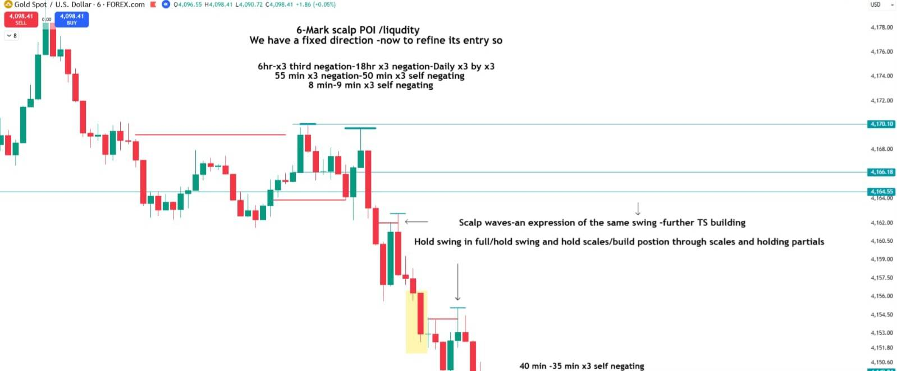

Chart annotations (6 min):

- Title: "6-Mark scalp POI /liqudity / We have a fixed direction -now to refine its entry so"
- Header: the TFS lines as on the 9 min chart.
- "Scalp waves-an expression of the same swing -further TS building", with arrows to a scalp lower high at about 4,162.8 and another at about 4,154.8.
- "Hold swing in full/hold swing and hold scales/build postion through scales and holding partials" (see [Management](#8--management-what-are-we-holding)).
- Teal tops at 4,170.10 (two touches); a yellow highlight on a falling candle at about 4,156-4,153.
- Bottom: "40 min -35 min x3 self negating"

The scalp waves are the swing being expressed on the scalp, and each one builds the [TS](/mrc-tasks/reference/top-down-extraction-cycle/#ts-build) further. The direction is fixed by now; the scalp only refines the entry.

### 6 · LTF: where is the precise entry? (4 min, 3 min)

> LTF - Where is the precise entry?
>
> Wait for the relevant LTF LAOL interaction, retest and qualifying EM. Refine with the optional 50% zone. Avoid chasing displacement.

#### 4 min: the LTF entry

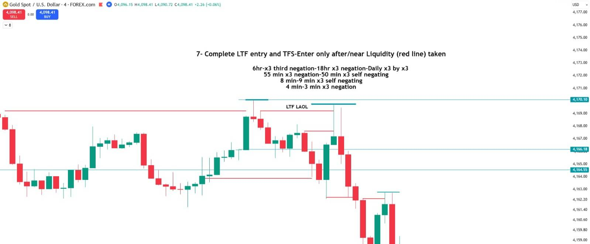

Chart annotations (4 min):

- Title: "7- Complete LTF entry and TFS-Enter only after/near Liquidity (red line) taken"
- Header: the TFS lines, plus "4 min-3 min x3 negation".
- "LTF LAOL" between two teal tops (about 4,170.10 and about 4,169.6).
- Red liquidity lines at about 4,169.3 (long, from the left), about 4,168.2, about 4,164 and about 4,162.3. Price sweeps above the red line, then turns down.
- Teal lines at 4,166.18 and 4,164.55.

**The entry rules here:** "Enter only after/near Liquidity (red line) taken" (chart title) and "Avoid chasing displacement." (stage text). [LAOL](/mrc-tasks/reference/liquidity/#the-last-area-of-liquidity) = last area of liquidity.

#### 3 min: the optional 50% refinement

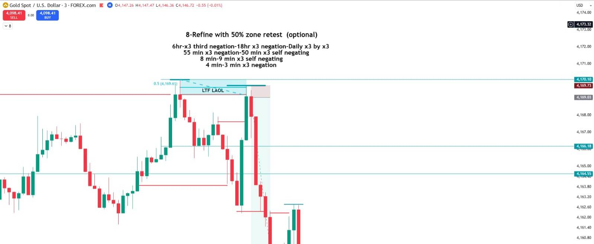

Chart annotations (3 min):

- Title: "8-Refine with 50% zone retest (optional)"
- Header: the TFS lines as on the 4 min chart.
- A Fibonacci "0.5 (4,169.61)" on the LTF LAOL range; an "LTF LAOL" box shaded between about 4,169.0 and 4,170.1.
- A short-position tool: the axis labels read about 4,169.03 (entry) and about 4,169.73 (stop); the target area extends below the visible chart.
- A red liquidity line at about 4,169.3 from the left, taken before the entry.

His LTF text calls this step optional: "Refine with the optional 50% zone." *The position values are read from the tool's axis labels and are approximate; the target is not visible.*

### 7 · Execution: is the entry structurally justified?

> EXECUTION - Is the entry structurally justified?
>
> Confirm the higher direction remains valid, the liquidity interaction has occurred, and the entry has a clear invalidation and acceptable risk.

No chart of its own. The checks, in his order:

1. The higher direction remains valid.
2. The liquidity interaction has occurred.
3. The entry has a clear invalidation and acceptable risk.

The 3 min chart above shows a position with a tight invalidation just above the LTF LAOL.

### 8 · Management: what are we holding?

> MANAGEMENT - What are we holding?
>
> Remember that the entry is LTF, but the intended movement is Swing. Use subsequent Scalp waves to manage continuation while respecting higher structural changes.

No chart of its own. His management note is on the [6 min chart](#6-min-scalp-waves): "Hold swing in full/hold swing and hold scales/build postion through scales and holding partials".

## Further advancements

In a reply to "Now A Step by step Sequence onto final clarification entry (level 1):":

> Further advancements consists of:
>
> .Following exact macro swing vs retracement swing interactions. 
> .Trading Forming swing intraday origin. 
> .Adding continuation entries / scalp waves 
> .Forming intraday setups 
> .Early buyers and sellers
>
> To be continued.

Announced, not yet given. Related material already here, as pointers only: forming TFS, [the power POI](/mrc-tasks/reference/timeframe-strength/#forming-the-power-poi); origin, [the three tradable points](/mrc-tasks/reference/top-down-extraction-cycle/#the-three-tradable-points) and Segment 3's "future origin lesson"; continuation entries / scalp waves, the [6 min chart](#6-min-scalp-waves); [early buyers/sellers](/mrc-tasks/reference/top-down-extraction-cycle/#laol-and-early-buyerssellers-3hr). Nothing in the source links these to Segment 3's "(locked) final advanced segement".

## Level 2: HCS and the limit-order approach

He posted this later, on its own, after the level 1 sequence.

> What does the HCS represent? Price establishes a protected, manipulated level, clears its LAOL, and marks the beginning of genuine premium price formation. Through previous tasks, one should already be well acquainted with its recognition.

This adds to the [HCS definition](/mrc-tasks/reference/terminology/#hcs) and to Segment 3's "FU formed-LAOL taken-respected" ([What HCS represents](/mrc-tasks/reference/terminology/#what-hcs-represents-segments)); it does not replace them.

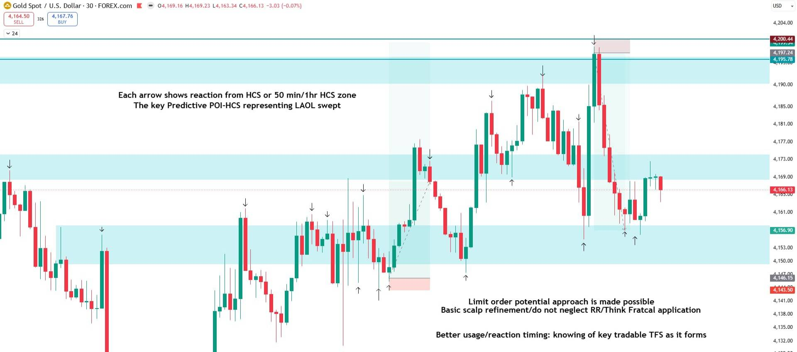

Chart annotations (XAUUSD 30 min):

- Upper left: "Each arrow shows reaction from HCS or 50 min/1hr HCS zone / The key Predictive POI-HCS representing LAOL swept"
- Lower right: "Limit order potential approach is made possible / Basic scalp refinement/do not neglect RR/Think Fratcal application"
- "Better usage/reaction timing: knowing of key tradable TFS as it forms"
- Three teal zones: the top one between about 4,190 and about 4,195.78 (a teal line at 4,200.44 above it), the middle one at about 4,169-4,173, the bottom one at about 4,150-4,156.90.
- Many down-arrows at highs touching the zones, and up-arrows at lows touching them.
- Two position boxes: a long from about 4,146.15 with its stop at 4,143.50, in the bottom zone (mid-chart); a short from 4,197.24 with its stop at 4,200.44, at the top zone (right side).

The zones are built from the HCS (50 min / 1hr) and price reacts at them again and again, so a limit order at the zone becomes possible, provided it is refined.

His conditions on the limit-order use:

> Its application for potential limit order execution: One must still understand and apply the fractality of the concept to refine RR and entry timing, lest one falls into the trap of trading like a retailer, relying on pure prediction without a firm bias grounded in developing price action.

> Or more fittingly rephrased from the professional execution perspective, the concise objective (level 2) is to recognise valid, tradable structures as they form, allowing earlier participation where justified. **A maximum of one entry before proper establishment.**

Level 1 waits for confirmation down the whole sequence. Level 2 participates earlier, at a structure as it forms, with at most one entry before it is properly established.

His own view of the cold limit order:

> The cold limit order approach is not particularly encouraged, yet It has been chosen to highlight to help bridge the gap for those struggling with more in-depth analysis — an easier foundational edge to build upon. The advanced hint lies in the fractality of the concept. By applying it across multiple timeframe layers, one begins to see how the predictive picture merges into our broader underlying framework of TFS

## Unresolved

Kept as written; the source does not define or settle these:

- **"x3 by x3"** ("Daily x3 by x3"): not defined.
- **"third negation"** ("6hr-x3 third negation"): not defined; third of what is not said.
- **"Weaker swing 1 origin vs swing 3"** (40 min chart): the arrows point to two red lines (about 4,138 and about 4,128), but the swings numbered 1 and 3 are not labelled.
- **"2 push breakout +retest requirement (early buyers/sellers)"** (1hr chart): not defined beyond the chart.
- **"Intraday closure within"** (the base edge): read here as an intraday FU / candle closing inside the swing retest, as the 40 min chart shows; the exact closure rule is not restated.
- **"EM"**: not spelled out; "entry model" is the more likely reading (inference).
- **"Active FU premium", "the premium edge", "main premium" vs "weaker internal levels"**: used, not defined. Kept in his wording.
- **The 3 min position values**: read from the axis labels (about 4,169.03 entry, about 4,169.73 stop); the target is off the chart.
- **The 6 min scalp chart**: the [five TFS categories](/mrc-tasks/reference/timeframe-strength/#the-five-tfs-categories) list nothing between 5 and 7 min, and this walkthrough uses 6 min (with 9 min) for the scalp. Kept as drawn.
- Announced but not given: the [further advancements](#further-advancements) ("To be continued.").

---

Related: [Recap & Puzzle](/mrc-tasks/tasks/segments/4/assignment/) · [The Top-Down Extraction Cycle](/mrc-tasks/reference/top-down-extraction-cycle/) · [Timeframe Strength (TFS)](/mrc-tasks/reference/timeframe-strength/) · [Terminology](/mrc-tasks/reference/terminology/) · [Liquidity](/mrc-tasks/reference/liquidity/) · [Segment 1](/mrc-tasks/tasks/segments/1/assignment/) · [Segment 2](/mrc-tasks/tasks/segments/2/assignment/) · [Segment 3](/mrc-tasks/tasks/segments/3/assignment/)
