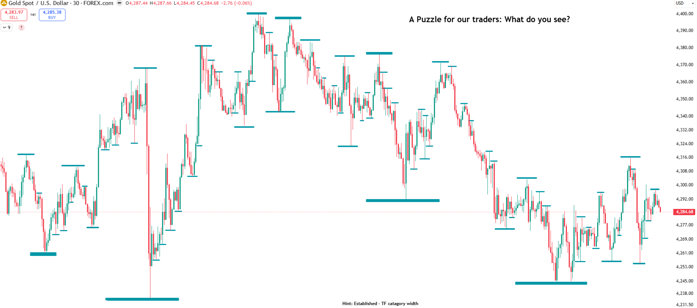

*After [Segment 3](/mrc-tasks/tasks/segments/3/) of Mr Casino's [Segments](/mrc-tasks/tasks/segments/). He does not number this assignment or call it a Segment; "Recap & Puzzle" is the site's label. No deadline and no count were given.*

## Where this fits

He introduces the assignment like this:

"We have covered combinations and manipulation pattern recognition in previous segments and bootcamp- a firm foundational knowledge for anyone who has studied diligently. As much as is publicly allowed to be released, yet protecting from leaks. Without spelling out every mechanical interaction flow. There is a reason the most condensed information is written in charts - it takes effort to extract- it speaks to genuine learners. Yet these reflection tasks were made so by the end of it, those genuine learners have all the tools to attain elite profitability via a step by step structure. Now the final explicit stages to bridge onto proper implementation."

"These reflection tasks" and "previous segments and bootcamp" appear to mean [Segments 1-3](/mrc-tasks/tasks/segments/) (the bootcamp opened under "#reflection - The next chapter"), but he does not name them. "Combinations" is not defined here.

## The puzzle

Chart annotations (XAUUSD, 30 min):
- Title: "A Puzzle for our traders: What do you see?"
- "Hint: Established - TF catagory width"
- Teal horizontal lines at the swing highs and lows. No arrows or other labels.

"What do you see in this chart? It speaks the language of true direction. One must understand the point and flow mentioned without extra input or hesitation by now - we have covered much pertaining to this explicitly to answer your questions. At least 80% should be understood if you have been following properly until now."

**He later explained the purpose of the puzzle** ([His debrief](#his-debrief-posted-later), collapsed below), but he has not posted solved markings or the "particular answers" he looks for. The hint is his. "Established" and "TF category" are terms from [Timeframe Strength](/mrc-tasks/reference/timeframe-strength/#the-five-tfs-categories).

## His debrief (posted later)

After the puzzle he posted what it was meant to show. It is collapsed so you can make your own attempt first.

Read after your own attempt

"Some of the purpose of the previous Puzzle:"

- "To showcase TS build up , starting from the highest swing (thickest TS line - the most power- our entries closest to that premium)"
- "The fractal expression - how each higher structure is made /refined/continued from its micro structure."
- "The importance of establishment. LTF builds the HTF - yet HTF authority is not to be ignored and auto includes its power upon establishment."
- "Price may take out early buyers/sellers, retrace and challenge or negate weaker TFS while the stronger structure remains intact."

**Lesson:** "The stronger established structure governs , while the weaker structures express, challenge and progressively build the higher movement."

He calls this "some of the purpose"; he does not present it as the full answer.

**The line widths.** "Thickest TS line - the most power" is his own key to the chart: the width of a line shows its strength, which matches the hint "Established - TF catagory width". *A description of the chart, not his answer:* the thickest lines are the lows at about 4,233, about 4,290 and about 4,245 (a double bottom), and a short thick line at about 4,262 on the far left; the highs at about 4,368 and about 4,397-4,400 are of medium width. Which of these is "the highest swing", and where "our entries closest to that premium" would be, he does not say.

**The base edge.** He highlighted this in a reply on the follow-on walkthrough ([the step-by-step sequence](/mrc-tasks/reference/step-by-step-entry-sequence/#the-base-edge), stage 3), and it ties back to the "line" strength above:

"Hilghlighted concept which had been a focus of previous tasks- the base edge - ones foundational profitability:"

"Swing retest , intraday closure within- the most fluent extraction area. Anything else and all refinement is built around its confirmed directional understanding (higher established TS "line" strength)"

**Not posted:** his solved markings of this chart and the specific "particular answers" he looks for. The follow-on walkthrough is a different XAUUSD chart (about 4,066-4,185, 18hr to 3 min), not this puzzle solved.

Related rules: [The LTF builds the HTF but HTF commands the LTF](/mrc-tasks/reference/timeframe-strength/#the-ltf-builds-the-htf-but-htf-commands-the-ltf) (TFS) · [early buyers/sellers](/mrc-tasks/reference/top-down-extraction-cycle/#laol-and-early-buyerssellers-3hr) (Top-Down Extraction Cycle).

## The task

"So the task thus:"

> Recap the last 3 sessions shared in ⁠🪙xauusd-main-focus🪙  and these last 3 segments of ⁠☯reflection☯  and make notes in a compiled document, with your own charts. Focus only only on the TFS/swing/intraday aspect- not liquidity or zones or even LTF execution yet. Then redo the puzzle gist with your own markings to the best of ability

"I do search for some particular answers which have been hinted to enough - Let us test and build on some comprehension and focus level now (precision trading skill requirement)."

"3 examples will be chosen to go over together-from least to best (to learn from even if one is wrong). And like so will advance through the stages of implementation step by step - from your own implementation first- on a collective end stage level."

## At a glance

His sequence, in his order:

| Step | What | His words |
|---|---|---|
| 1 | Recap the last 3 sessions shared in the xauusd-main-focus channel | "Recap the last 3 sessions shared in 🪙xauusd-main-focus🪙" |
| 2 | Recap the last 3 segments of reflection | "and these last 3 segments of ☯reflection☯" |
| 3 | Compile notes into one document, with your own charts | "make notes in a compiled document, with your own charts" |
| 4 | Focus only on the TFS / swing / intraday aspect | "Focus only only on the TFS/swing/intraday aspect" |
| 5 | Leave out liquidity, zones and LTF execution at this stage | "not liquidity or zones or even LTF execution yet" |
| 6 | **Then** redo the puzzle with your own markings | "Then redo the puzzle gist with your own markings to the best of ability" |

- **Standard:** "At least 80% should be understood if you have been following properly until now."
- **Deadline:** none stated. **Count:** none beyond one compiled document and the puzzle.
- **Afterwards:** he chooses 3 examples to go over together, "from least to best (to learn from even if one is wrong)".

## What to recap

**The last 3 segments of reflection.** This appears to refer to Segments 1-3, but the source does not explicitly identify them by route or title. Only these three carry TFS / swing / intraday teaching:
- [Segment 1: Direction Through Swing & Intraday Points](/mrc-tasks/tasks/segments/1/assignment/) ("observing true directional flow through swing and intraday points")
- [Segment 2: Scalp Premium Flow & TS Build](/mrc-tasks/tasks/segments/2/assignment/)
- [Segment 3: Bringing It All Together in Action](/mrc-tasks/tasks/segments/3/assignment/)

Recap only their direction layer: liquidity, zones and LTF execution are left out "yet", although Segments 2 and 3 teach them.

**The last 3 xauusd-main-focus sessions.** These three sessions are **not yet in this knowledge base**. Nothing from them is summarised or reconstructed here, so this page does not cover the whole source of the recap.

For TFS terms: [Timeframe Strength](/mrc-tasks/reference/timeframe-strength/) (the five categories, established vs forming). For Segments 1-3 in one place: [The Top-Down Extraction Cycle](/mrc-tasks/reference/top-down-extraction-cycle/).

## What came next: the step-by-step sequence (level 1)

After the puzzle he posted:

"Now A Step by step Sequence onto final clarification entry (level 1):"

It appears to be the "stages of implementation" this assignment said would follow "step by step" (an inference; he does not link the two explicitly). It adds what the recap left out "yet": liquidity and LTF execution. His summary:

"To memorise:" **"Authority → Premium → Interaction → EM/TFS → Scalp → LTF Liquidity → Entry → Management."**

"Swing tells WHAT to follow. Intraday tells WHERE the main interaction is. Scalp tells HOW the movement is developing. LTF tells WHEN and WHERE to execute."

His eight stages, each a question:

1. AUTHORITY - What are we following?
2. PREMIUM - Where should price interact?
3. INTERACTION - Has the main structure activated?
4. CONFIRMATION - What TFS and EM support it?
5. SCALP - How is the Swing being expressed?
6. LTF - Where is the precise entry?
7. EXECUTION - Is the entry structurally justified?
8. MANAGEMENT - What are we holding?

He teaches it through one worked example on a different XAUUSD chart (18hr down to 3 min, ten charts). The full sequence, with every stage's text, the charts, the base edge, his further advancements and the later "level 2" (HCS and limit orders), is on [The Step-by-Step Entry Sequence](/mrc-tasks/reference/step-by-step-entry-sequence/).

## Unresolved

- "Redo the puzzle gist": most likely the puzzle chart itself, marked up by you; it could also mean the same idea on your own chart. Kept as he wrote it.
- Which 3 xauusd-main-focus sessions are meant, and their content (not in this knowledge base).
- "Combinations" (in "combinations and manipulation pattern recognition"): not defined.
- "The point and flow mentioned": not restated here. The closest he comes is the Lesson in [his debrief](#his-debrief-posted-later) and the roles line of the [step-by-step sequence](#what-came-next-the-step-by-step-sequence-level-1), but he does not say they are the same.
- The puzzle's answer: he later gave its purpose and lesson ([his debrief](#his-debrief-posted-later)); his solved markings and the "particular answers" he looks for are not given.
- "A collective end stage level": not explained.

## Still to come

- His solved markings / "particular answers" for the puzzle, and the 3 examples reviewed together.
- The next "stages of implementation", which he says follow "step by step": now posted, most likely as the [step-by-step sequence (level 1)](#what-came-next-the-step-by-step-sequence-level-1) and its later level 2 (an inference). Whether the 3 examples were reviewed first is not in the source.
- His "Further advancements" after level 1, five topics ending "To be continued." ([listed here](/mrc-tasks/reference/step-by-step-entry-sequence/#further-advancements)).
- Not the same as the "future (locked) final advanced segement" Segment 3 points to ([Still to come](/mrc-tasks/tasks/segments/3/assignment/#still-to-come)); nothing links the two.

---

Related: [Segment 1](/mrc-tasks/tasks/segments/1/assignment/) · [Segment 2](/mrc-tasks/tasks/segments/2/assignment/) · [Segment 3](/mrc-tasks/tasks/segments/3/assignment/) · [Timeframe Strength (TFS)](/mrc-tasks/reference/timeframe-strength/) · [The Top-Down Extraction Cycle](/mrc-tasks/reference/top-down-extraction-cycle/) · [Earning the Advanced Stage](/mrc-tasks/misc/earning-the-advanced-stage/)
